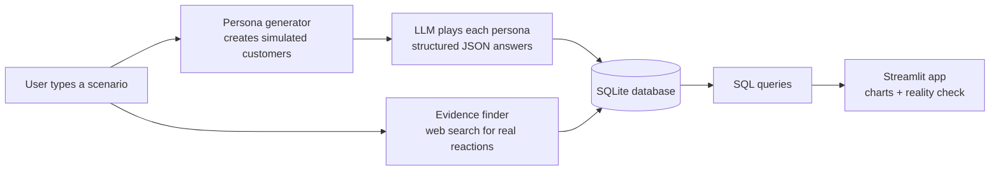

# Consumer Reaction Simulator

**Predict how customers will react to a business decision before it happens, then check the prediction against what real customers actually did.**

🔗 **Live app:** [https://YOUR-APP-NAME.streamlit.app](https://YOUR-APP-NAME.streamlit.app)

Built with Python, OpenAI's API, SQLite, and Streamlit.

---

## What it does

A business is about to raise prices, change a policy, or launch a product, and wants to know how customers will react. Real surveys are slow and expensive. This app runs a **simulated survey** in under a minute:

1. You describe a scenario in plain English, like *"Netflix is raising the price of its standard plan by $3 per month."*
2. The app creates a crowd of **simulated customers (personas)**, each with a realistic mix of age, income, location, household, price sensitivity, brand loyalty, product usage, and customer status.
3. Each persona is played by a large language model (LLM) and decides how it would react: accept, reduce, delay, switch to a competitor, or reject.
4. Every answer is stored in a SQL database and visualized as charts, group breakdowns, and quotes in the personas' own words.
5. If the scenario **really happened**, the app automatically searches the web for how real customers reacted and compares the simulation against reality.

That last step is what separates this from a demo. A simulator that's never checked against reality can't be trusted, so this one checks itself whenever it can. Checking it against reality is also how most of the problems described in [What we got wrong](#what-we-got-wrong-and-how-we-fixed-it) were found.

---

## How it works



The simulation and the evidence search run **separately**. The personas never see the real-world evidence, so they can't copy the real outcome.

### 1. Persona generator
Each persona is built by drawing attributes using weighted random sampling. If about 18% of U.S. adults are aged 25–34, about 18% of personas will be too. A fixed random seed makes runs repeatable, so the same scenario always goes to the same crowd, which makes comparisons between scenarios fair.

Each persona also has a **customer status**: a current paying customer, a non-paying user (for example, someone using a shared account or a free version), or not a customer at all. This lets the simulator predict customers being **gained**, not just lost.

### 2. Structured reactions
Each persona receives its description as a **system prompt**, followed by the scenario. OpenAI's **structured outputs** force every answer into a strict JSON schema:

| Field | Values |
|---|---|
| `decision` | accept, reduce, delay, switch, reject |
| `intent_score` | 1–10 likelihood to pay for the product |
| `sentiment` | negative, neutral, positive |
| `reason` | 1–2 sentences in the persona's own voice |

The order of the decision options is **shuffled per persona** to counter LLM *position bias*, the tendency to favor options listed first.

### 3. Scenario runner
Requests run in parallel (5 at a time) with **automatic retries and exponential backoff**, so a temporary API error doesn't crash a large run. Each answer is saved the moment it arrives.

### 4. Real-world evidence finder
A two-step LLM pipeline:
1. **Research:** the model uses OpenAI's web search tool to find surveys, sales or subscriber data, and news coverage, and writes notes with citations.
2. **Structure:** a second request converts the notes into a fixed format using *only* what the notes contain, separating what customers **said** from what they **actually did**.

Three **code-level safeguards** then decide whether the evidence counts:
- Scenarios written about "our," "my," "we," or "us" skip the search entirely, since a user's own business has no public evidence.
- The model must name the specific company the scenario is about.
- The model must confirm the evidence describes this exact event, not general trends or a different company.

If any check fails, the code treats the scenario as hypothetical, whatever the model concluded.

### 5. Reality check
For real events with strong or moderate evidence, the app compares:
- **Behavior:** did the simulation predict the business gaining or losing customers, and did that match reality?
- **Mood:** did the simulated sentiment match how customers felt?

Each comparison gets a **Match / Partial match / Mismatch** rating, along with key findings, an evidence strength rating, and links to every source. When evidence is weak, the app shows no verdict at all.

---

## Results

These come from development runs of 20–100 personas, so treat exact percentages as rough. Larger runs (100 personas) are noted where used.

### The simulator responds to severity
The same 20 personas reacted very differently to two Netflix price increases:

| Decision | $3/month increase | $15/month increase |
|---|---|---|
| accept | 50% | 0% |
| reduce | 50% | 60% |
| reject | 0% | 35% |
| delay | 0% | 5% |

### Personas use their attributes
In the $3 scenario, average purchase intent fell as price sensitivity rose: 7.4 (low), 6.0 (medium), 5.67 (high). Of the low-sensitivity personas, 9 of 10 accepted the increase; none of the high-sensitivity personas did.

### Personas adapt to the product
Nobody told the personas how different products work, but their reactions changed with the product:
- **Netflix price increase:** most common reaction was *reduce* (downgrade the plan)
- **iPhone price increase (100 personas):** most common reaction was *delay* (50%), waiting to upgrade
- **Small coffee brand price increase (100 personas):** 72% would *reduce* and 24% would *switch* to another brand, far more switching than for Netflix or the iPhone, which fits a small brand with many substitutes

### Validation against Netflix's password-sharing crackdown (2023)
The evidence finder found that sign-ups roughly doubled in the days after the U.S. rollout and Netflix gained subscribers, even though many customers had said they were unhappy.

| Version | Simulation predicted | Reality | Verdict |
|---|---|---|---|
| Before customer status was added | Losing customers | Gained customers | Wrong direction |
| After, 30 personas | No clear change (1 of 13 non-customers gained, 0 of 17 customers lost) | Gained customers | Partial match |
| After, 100 personas | No clear change (3 of 44 non-customers gained, 3 of 56 customers lost) | Gained customers | Partial match |

The fix moved the prediction from the wrong direction to a partial match. The simulator still underestimates how many non-paying users, like password borrowers, would start paying. The personas were also calmer than real customers: 69% neutral and 30% negative, while real reactions were mostly negative. The 30- and 100-persona runs gave nearly identical moods, suggesting the result is stable rather than noise.

---

## What we got wrong (and how we fixed it)

Most of the project's improvements came from finding its own mistakes. Each one below was caught by testing the simulator against expectations or against real-world evidence.

### 1. Nobody ever chose "switch"
**Problem:** Across the first three scenarios, including an iPhone price increase where switching to Android is the obvious alternative, 0% of personas chose *switch*.

**Causes:** "Switch" and "reject" overlapped (is cancelling Netflix for Hulu a switch or a reject?), personas didn't know how much they used the product, and the options were always listed in the same order, with *accept* first. LLMs tend to favor options listed early.

**Fix:** Clarified that *reject* means cancelling without a replacement, added a usage level attribute, asked personas to consider their realistic alternatives (including staying), and shuffled the option order for each persona.

**Result:** *Switch* started appearing, from 2.5% for the iPhone, where brand loyalty is famously high, to 24% for a small coffee brand. The prompt was deliberately not pushed toward switching, to avoid biasing later validation.

### 2. The first evidence finder had no sources and misread the question
**Problem:** The first version asked one request to search the web *and* fill a strict template. It returned no source links, ignored length limits (a "1–2 sentence" summary became several paragraphs), and described what *Netflix* said instead of what *customers* said vs. did.

**Fix:** Split it into a two-step pipeline: research with citations first, then a separate structuring step that may only use the research notes.

**Result:** Real sources (TechCrunch, MacRumors, Axios, and others), concise summaries, and findings about customer behavior with hard numbers.

### 3. A "Match" that wasn't really a match
**Problem:** On the first Netflix comparison, the app showed a green **Match** because both sides were labeled "mixed." But the simulated crowd was 83% *neutral*, while the real public was split between anger and action. They matched only because the labeling rule had no "neutral" category.

**Fix:** Added a "mostly neutral" label, and made **behavior** (gaining or losing customers) the headline comparison, since that matters more to a business than mood.

### 4. The simulator couldn't predict new customers
**Problem:** For Netflix's password crackdown, the simulator predicted customer losses, but Netflix actually gained subscribers.

**Cause:** Every persona was an existing customer. The real growth came from people borrowing passwords signing up for their own accounts, and the simulator had no way to represent them.

**Fix:** Added customer status (current customer, non-paying user, not a customer), so non-customers who would start paying count as new customers.

**Result:** The prediction moved from the wrong direction to a partial match (see Results). It still underestimates new sign-ups.

### 5. A verdict that hinged on one persona
**Problem:** The first rerun after the fix used 30 personas. The net gain was 1 of 30 (3.3%), just under the 5% cutoff for "gained customers." One more sign-up would have flipped the verdict to a full Match.

**Fix:** Reran with 100 personas. The verdict held (net change of zero), so the result no longer depends on a single persona.

### 6. False matches for made-up businesses
**Problem:** A hypothetical scenario, *"Our small coffee brand raises the price of a bag from $14 to $18,"* was matched to real news about rising coffee prices in general, and the app showed a green **Match**. This is the most dangerous kind of error, because it makes the simulator look validated when it isn't.

**First attempt:** Added prompt instructions saying only specific, named events count. This **didn't work**: a second test, *"our coffee shop has increased the whole menu's pricing by 5 dollars,"* still produced verdicts.

**Fix:** Moved the safeguards into code (see How it works, step 4). The model provides information, like the company name and whether the evidence matches, but the code makes the final decision.

**Result:** Both coffee scenarios are now correctly treated as hypothetical, while the Netflix crackdown still gets a full reality check.

**Lesson:** Prompt instructions are suggestions to the model, not guarantees. Rules that must always hold belong in code.

### 7. Vague scenarios get matched to the wrong event
**Problem:** *"Apple raises the price of the new iPhone by $100"* doesn't say which iPhone or when. The evidence finder concluded Apple "lost customers," while also reporting that what customers actually did was "Unknown," a contradiction suggesting weak evidence. Apple also doesn't report sales by model, so clean evidence is hard to find.

**Status:** Partly addressed by the safeguards above. Scenarios work best when they name a specific company, product, place, and date, as the Netflix one does.

---

## Tech stack

| Tool | What it is | How it's used here |
|---|---|---|
| **Python** | Programming language | All project code |
| **OpenAI API** (`gpt-4.1-mini`) | LLM access over the internet | Plays each persona; researches real-world evidence |
| **Structured outputs** | Forces LLM answers into a JSON schema | Makes 100 answers countable instead of 100 paragraphs |
| **OpenAI web search tool** | Lets the LLM search the web and cite sources | Finds real customer reactions to past events |
| **SQLite** | A full SQL database stored in one file | Stores personas, scenarios, responses, and evidence |
| **pandas** | Data tables in Python | Runs SQL queries and holds results for charts |
| **Streamlit** | Turns a Python script into a web app | The interactive interface |
| **Plotly** | Interactive charting library | All charts, with hover-for-detail |
| **python-dotenv** | Loads secrets from a `.env` file | Keeps the API key out of the code |
| **concurrent.futures** | Python's built-in parallelism tools | Runs persona requests 5 at a time |
| **Regular expressions** (`re`) | Text pattern matching | Detects scenarios about the user's own business |
| **GitHub Codespaces** | Cloud development environment | Where the project was built |
| **Streamlit Community Cloud** | Free app hosting | Hosts the live app |

---

## Database design

A relational schema with four linked tables:

| Table | One row per | Key columns |
|---|---|---|
| `personas` | Simulated customer | persona_id, age_group, income, location, household, price_sensitivity, brand_loyalty, usage_level, customer_status |
| `scenarios` | Scenario run | scenario_id, description, model, created_at |
| `responses` | One persona's reaction to one scenario | response_id, scenario_id → scenarios, persona_id → personas, decision, intent_score, sentiment, reason |
| `evidence` | Real-world check for one scenario | scenario_id → scenarios, is_real_event, reported_sentiment, net_customer_effect, stated_vs_actual, key_findings, evidence_strength, sources |

`responses` stores only IDs pointing to `personas` and `scenarios`, so the same personas can react to many scenarios without being stored repeatedly. `evidence` has a one-to-one relationship with `scenarios`, so each scenario is searched once, which keeps results consistent (LLM output varies between runs) and avoids paying for repeat searches.

Earlier database versions were kept as `simulations_v1.db` and `simulations_v2.db` so results could be compared before and after each design change.

## SQL highlights

All analysis SQL lives in [`src/queries.py`](src/queries.py). Techniques used:

- **JOINs** connecting responses to persona attributes, and **LEFT JOIN** to keep scenarios with no responses
- **Window functions:** `SUM(COUNT(*)) OVER (PARTITION BY ...)` for percentages within each group
- **CTEs with `ROW_NUMBER()`** for "top N per group," used to pick sample quotes for each decision
- **Conditional aggregation:** `SUM(CASE WHEN ...)` and boolean sums for counts like customers gained and lost
- **`ATTACH DATABASE` and `FULL OUTER JOIN`** to compare results across database versions
- **Parameterized queries** (`?` placeholders) and a **column whitelist** to prevent SQL injection

Example: customers gained and lost, by customer status.

```sql
SELECT
    SUM(p.customer_status != 'current customer' AND r.decision = 'accept') AS gained,
    SUM(p.customer_status = 'current customer'
        AND r.decision IN ('switch', 'reject')) AS lost
FROM responses r
JOIN personas p ON r.persona_id = p.persona_id
WHERE r.scenario_id = ?;
```

---

## Project structure

```
├── app.py                  # Streamlit app
├── requirements.txt        # Python libraries
├── src/
│   ├── personas.py         # Persona generator
│   ├── simulator.py        # Sends a scenario to one persona, returns structured JSON
│   ├── runner.py           # Runs a scenario across many personas in parallel
│   ├── database.py         # SQLite schema and save/load functions
│   ├── queries.py          # All analysis SQL
│   └── evidence.py         # Two-step web evidence pipeline with safeguards
├── notebooks/              # Step-by-step development and testing
└── data/processed/
    └── simulations.db      # Results database (demo scenarios)
```

---

## Run it locally

```bash
git clone https://github.com/AtharvaKarekar28/Marketing.git
cd Marketing
python -m venv .venv
source .venv/bin/activate
pip install -r requirements.txt
```

Create a `.env` file in the project root:

```
OPENAI_API_KEY=sk-your-key-here
```

Then run:

```bash
streamlit run app.py
```

A 100-persona run costs roughly 10–20 cents with `gpt-4.1-mini`, plus a small fee per web search for the evidence check.

---

## Limitations

- **Simulated, not real, customers.** Personas reflect how an LLM imagines people behave. They were consistently calmer than real customers, and research has found LLM personas can be more similar to each other than real people are and can carry the model's own biases.
- **Underestimates new customers.** Even after adding customer status, the simulator predicted far fewer sign-ups than really happened in the Netflix case.
- **Knowledge leakage.** For past events, the model may already know what happened from its training data, which could make the simulation look more accurate than it really is.
- **Validation was tuned on Netflix.** The customer status fix was designed after the Netflix result, so Netflix no longer counts as an independent test. This is a form of overfitting to the test.
- **Only one fully validated event.** The track record so far is a single real event, which isn't enough to measure general accuracy.
- **Approximate population weights.** Demographic weights are rounded U.S. figures. Price sensitivity, loyalty, usage, and customer status weights are assumptions.
- **Design-choice thresholds.** The 60% cutoff for mood labels and the 5% cutoff for gained/lost customers are judgment calls, not standards.
- **Evidence depends on what's published.** The reality check is limited to what's reported online, and LLM-written findings can occasionally overstate what the sources say, so the sources are always shown for verification.
- **Vague scenarios work poorly for validation.** Scenarios need a specific company, product, and date to be matched to the right real event.
- **U.S. consumer focus.** Personas represent general U.S. consumers, not niche or business-to-business audiences.

## Future work

- **Independent validation** on past events the simulator wasn't tuned on (for example, Unity's 2023 runtime fee), to build an honest track record.
- **Causal inference on real data:** measure an event's true effect with difference-in-differences using subscriber data, search trends, and competitor comparisons.
- **Control scenarios:** run each scenario alongside a "nothing changed" version, so the app shows the effect of the change itself. For example, many people delay buying a new phone even when the price doesn't change.
- **Reliability checks:** stability across repeated runs (margins of error), automatic severity checks, and agreement between two different LLMs.
- **Multi-agent social influence:** let personas see each other's reactions over several rounds to study how backlash spreads or fades.
- **Census-based weights** for the demographic attributes.

---

## Author

**Atharva Karekar** · M.S. Applied Data Science, Syracuse University
GitHub: [AtharvaKarekar28](https://github.com/AtharvaKarekar28)